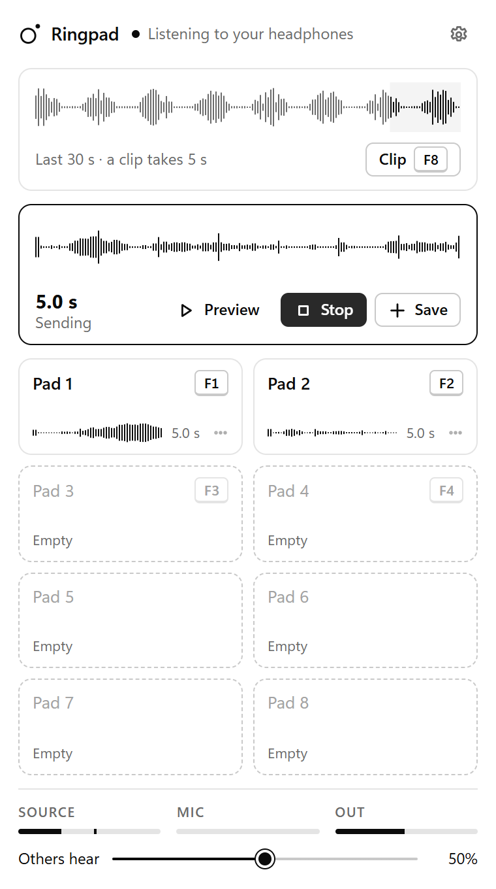
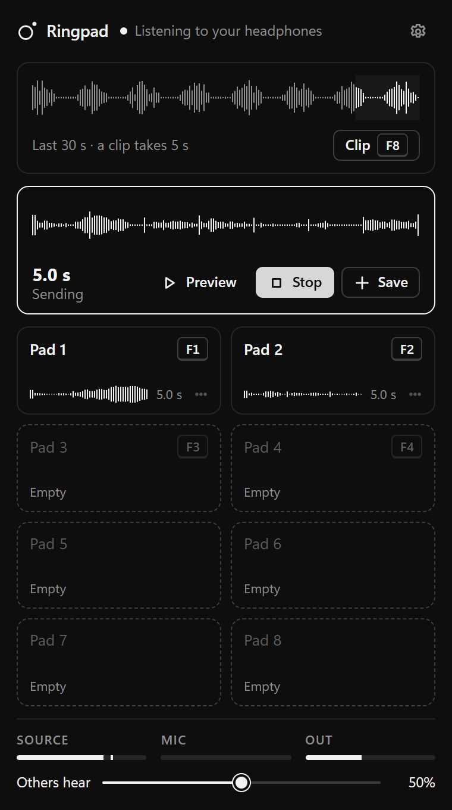

# Ringpad

Ringpad is a soundboard for Windows with instant replay. It keeps the last 30 seconds of what
your PC plays, so when a teammate says something worth hearing again, one key clips it and
another plays it into your mic. It also has eight pads for your own sounds.

<p>
  
  
</p>

Free and open source (MIT). Windows 10 and 11. Everything runs on your PC.

## How it works

1. Ringpad records the audio you already hear into memory: everything, one app (say, Discord),
   or one output device.
2. **Clip** (F8) takes the last 5 seconds, trims the silence and evens out the level, then plays
   it to you so you can check it.
3. **Send** (F7, or the upper side button on your mouse) plays it to everyone, mixed with your
   real mic, through a virtual microphone.
4. **Save** (F6, then a pad key) keeps a clip on a pad. You can also drop a WAV, MP3, OGG or FLAC
   file on a pad.

Windows only lets an app add a microphone through a virtual audio cable, so Ringpad needs one.
[VB-CABLE](https://vb-audio.com/Cable/) is free and takes a minute to install. Voicemod's and
VoiceMeeter's virtual devices work too.

## Install

1. Install [VB-CABLE](https://vb-audio.com/Cable/) (or skip this if you have Voicemod or
   VoiceMeeter) and restart.
2. Download `Ringpad_x.y.z_x64-setup.exe` from
   [Releases](https://github.com/ZHANGV25/ringpad/releases) and run it. It installs for your user
   only, with no admin prompt. Windows may say it "protected your PC" because the installer is
   not signed yet: choose **More info**, then **Run anyway**.
3. Ringpad opens a short setup: it finds the cable, plays a test tone, asks what to record and
   shows your keys.
4. In Discord or your game, set your **microphone** (input device) to the cable's output, for
   example **CABLE Output (VB-Audio Virtual Cable)**.

That's it. Your voice still reaches your team: Ringpad passes your real mic through the same
cable. [docs/SETUP.md](docs/SETUP.md) has step-by-step setup for Discord and Valorant, how to
record only voices, and fixes for common problems.

## Keys

| Key | Does |
| --- | --- |
| F8 | Clip the last 5 s and play it to you |
| F7, or upper side mouse button | Send the clip to everyone |
| F9 | Stop anything playing |
| F6, then a pad key | Save the clip to that pad |
| F1 to F4 | Play pads 1 to 4 (pads 5 to 8 have no key until you set one) |

Change any of them in **Settings > Hotkeys**, including mouse side buttons. Keys work while the
game has focus and while you hold movement keys. Ringpad reads them with Raw Input, the way games
do, so it adds no input lag and never blocks a key.

## Privacy

- Ringpad records only audio your PC already plays, and keeps it in memory until you clip it.
- Clips and pads stay on your PC in `%APPDATA%\Ringpad`. Clips are deleted after 7 days; change
  that in **Settings > General**.
- No accounts, no telemetry, no network calls. The only links it opens are the ones you click.

## Use it kindly

Ringpad replays what other people said. Clip what's funny or useful. Replaying someone to mock or
harass them is unkind and breaks the rules of most games and Discord servers, and it can get you
banned.

## Build from source

You need Rust (stable), Node 22, and the WebView2 runtime (built into Windows 11).

```bash
npm install
npm run dev
```

`npm run dev` starts the app with hot reload. To work on the interface alone in a browser, run
`npm run dev --workspace ui` and open http://localhost:1420: it uses a fake audio engine.

Tests:

```bash
cargo test --workspace
npm test --workspace ui
```

See [CONTRIBUTING.md](CONTRIBUTING.md) for the layout and code style.

## Layout

| Path | What |
| --- | --- |
| `crates/core` | Audio engine with no OS code: history buffer, clips, pads, mixing, ducking |
| `crates/windows` | WASAPI capture and playback, per-app capture, device changes, Raw Input hotkeys |
| `app` | Tauri 2 shell: commands, settings, pads on disk, tray |
| `ui` | React and TypeScript interface, monochrome light and dark themes |
| `docs/IPC.md` | Commands and events between the interface and the app |

## License

[MIT](LICENSE)
