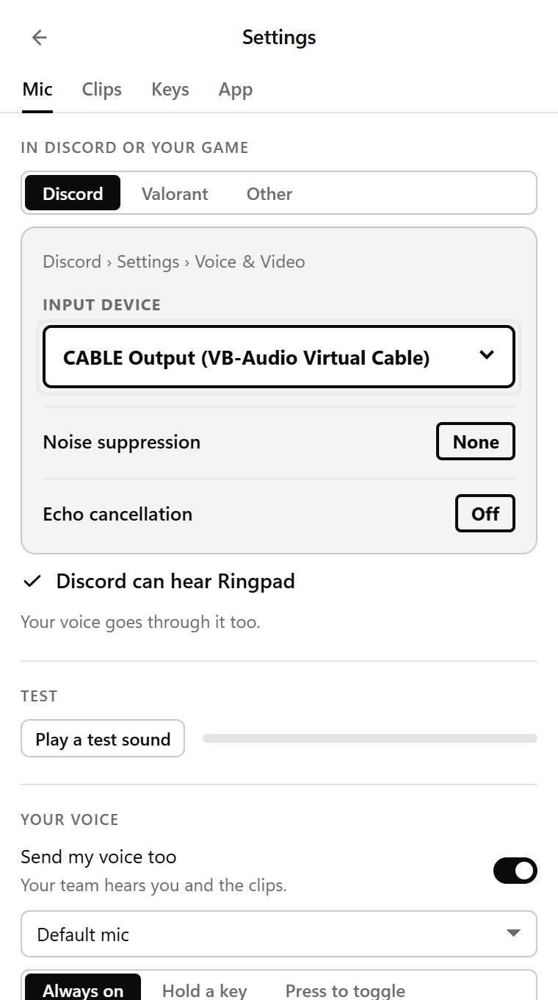

# Setting up Ringpad

Ringpad sends clips through a virtual cable. Audio played into the cable's **input** comes out of
its **output**, and Discord or your game uses that output as your microphone. Ringpad mixes your
real mic into the same cable, so your team hears you and the clips together.

| Cable | Ringpad plays into | Pick this as your microphone |
| --- | --- | --- |
| VB-CABLE | CABLE Input (VB-Audio Virtual Cable) | CABLE Output (VB-Audio Virtual Cable) |
| Voicemod | Voicemod Virtual Audio Device | Microphone (Voicemod Virtual Audio Device) |
| VoiceMeeter | VoiceMeeter Input | VoiceMeeter Output |

Settings > Mic shows the name to pick in your app, and ticks it off once the app uses it. To use
a different cable, open **Virtual cable** at the bottom of that page.

If you use Voicemod's device, keep the Voicemod app closed. Ringpad needs only its driver, and the
app would play its own audio into the same microphone.

## Discord

1. **Discord > User Settings > Voice & Video > Input Device:** CABLE Output (VB-Audio Virtual
   Cable).
2. On the same page, turn off **Noise Suppression** (Krisp) and **Echo Cancellation**. Both
   treat clips as background noise and cut them.
3. **Ringpad > Settings > Clips > Clip from:** pick **Discord** under "One app only". Clips
   then hold only what Discord plays: voices, not your game or music.
4. Keep **Send my voice too** on (Settings > Mic), so Discord still hears your real mic.

Ringpad shows "Discord can hear Ringpad" once Discord uses the cable, which is while you are in a
voice channel or on the Voice & Video page. To hear it, start Discord's **Mic Test**, then press
**Play a test sound** in Ringpad's Settings > Mic. Discord plays the tone back to you.

## Valorant

1. **Valorant > Settings > Audio > Voice Chat > Input Device:** CABLE Output (VB-Audio Virtual
   Cable).
2. Valorant team chat is push-to-talk. Let Ringpad hold the key while a clip plays (setup offers
   it, or Settings > Mic > Game talk key), or switch voice chat to open mic.

Valorant plays voices and game sound from one process, so recording "one app" still gets gunshots
and music in your clips. To record only voices, use a spare output, below.

### Voices only, with a spare output

Valorant (like many games) can play voice chat to a different device from game sound. If your PC
has an output with nothing plugged into it, such as **Realtek Digital Output**, send voices there
and let Ringpad record that device and play it to you.

1. **Windows Settings > System > Sound > Realtek Digital Output:** set its volume to 100%. Do not
   make it your default device.
2. **Valorant > Settings > Audio > Voice Chat > Output Device:** Realtek Digital Output.
3. **Ringpad > Settings > Clips > Clip from:** pick **Realtek Digital Output** under "An output
   device", then turn on **Play it in my headphones**.

You now hear teammates through Ringpad, about 50 ms later than usual, and clips hold only their
voices. When you play without Ringpad running, set Valorant's voice output back to your
headphones, or you won't hear voice chat.

## Other games

Set the game's voice chat microphone to the cable's output, as above. If the game can send voice
chat to its own output device, the spare-output setup above works the same way.

## Push-to-talk games

For games or Discord, set voice chat to voice activity on the cable when possible. Use a low
threshold, and turn off noise suppression such as Krisp for the cable when the app lets you.

Valorant team voice is push-to-talk only. In Ringpad's Settings > Mic > **Game talk key**, pick
**During clips**, keep the key as **V** if that is your Valorant team key, and optionally (under
**Timing**) limit it to Valorant so the key is pressed only while Valorant is in front.

If the key never registers and the game runs as administrator, run Ringpad as administrator too.

## Fixing problems

**Teammates don't hear clips.** Check the "Your team hears" meter at the bottom of the window moves
when you press F7. If it does, the game or Discord is using the wrong microphone (Settings > Mic
says which one it is using), push-to-talk isn't held, or noise suppression is cutting the clip. If
it doesn't, you have no clip yet: press F8 first.

**I hear nothing at all.** Windows may be playing all sound into the cable. Settings > Mic warns
about this. Set your Windows sound output back to your headphones.

**Teammates don't hear me any more.** Turn on **Send my voice too** in Settings > Mic, and check
the mic under it.

**New clips contain my earlier clips.** Ringpad pauses recording while it plays a clip in your
headphones, but it can only do that when it knows which device your headphones are. Pick them
under **Plays in** in Settings > Clips.

**My mouse side button does nothing.** Mouse software (G Hub, Synapse, iCUE) can remap side
buttons to keys. Open Settings > Keys, press **Change** next to Send, and press the button:
whatever it sends shows up there.

**Keys don't work in one game.** If the game runs as administrator, Windows hides its key presses
from apps that aren't. Run Ringpad as administrator too.

**"No virtual mic yet".** Press **Install VB-CABLE** in Settings > Mic and click **Yes** when
Windows asks. If Ringpad then asks for a restart, restart Windows. You can also install
VB-CABLE yourself from [vb-audio.com/Cable](https://vb-audio.com/Cable/) and press
**Check again**.

**Removing VB-CABLE.** Uninstalling Ringpad leaves VB-CABLE in place, since other apps may use it.
To remove it, run `VBCABLE_Setup_x64.exe` from VB-CABLE's download (or from Ringpad's install
folder, under `vbcable`), choose **Remove Driver**, and restart.
